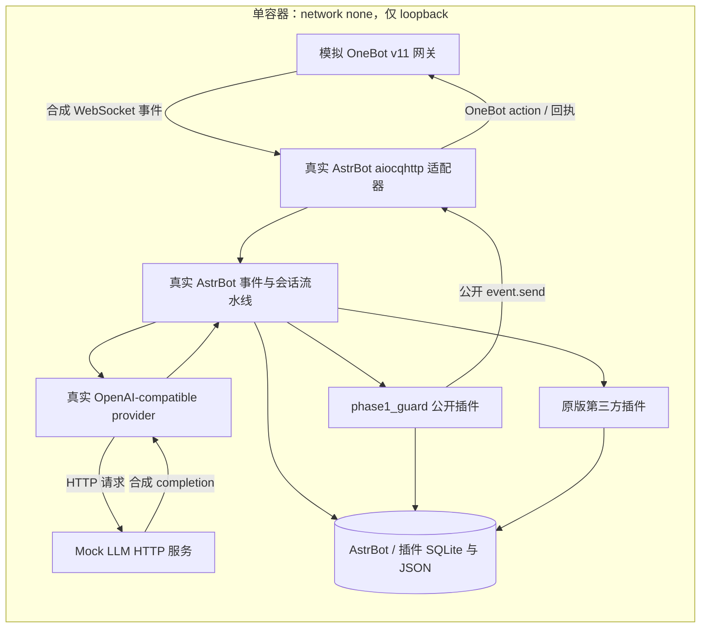

# Phase 1 架构与运行边界

项目复用固定的 AstrBot `v4.29.1`，通过独立配置、外置运行目录、公开插件 API 和测试对端完成离线系统集成。AstrBot 上游源码不修改；第三方插件保持原始固定提交，仅在本地评估目录内加载。版本与许可证分别见 [依赖核查](dependencies.md)、[兼容性](compatibility.md)。最终验收状态见 [Phase 1 报告](phase1-validation.md)。

P0 的 T01–T20 对应用户完整任务书，执行索引见 [Phase 1 范围](phase1-scope.md)。P1 扩展能力独立分级，不以 Mock、静态源码声明或成功加载替代真实功能测试。

## 真实消息链路

唯一替代外部服务的是 OneBot 网关与 LLM。测试通过真实 WebSocket 输入消息，检查 Mock 收到的真实 HTTP 请求，再检查 OneBot 对端收到的出站 action 与回复正文。不直接调用 AstrBot 消息处理函数来代替消息链路，也不向业务数据库预写“成功”记录。

模拟 OneBot 负责协议握手、消息事件、框架需要的查询动作、发送动作回执和错误注入。Mock LLM 负责 OpenAI-compatible HTTP 契约、确定性回复、超时/错误/畸形响应注入。它们不证明 QQ 登录、腾讯侧消息投递、真实模型质量或图片理解能力。

## 组件职责

| 组件 | 责任 | 验证边界 |
| --- | --- | --- |
| AstrBot 原生核心 | OneBot 接入、白名单、会话隔离、上下文、provider、插件生命周期、SQLite、原生调度 | 使用未修改的固定版本 |
| `launch_astrbot.py` | 初始化 runtime；校验配置；调用原始生命周期；加载外置 persona；应用公开命令权限配置；响应停机信号 | headless，不启动 WebUI，不替换适配器/provider/数据库 |
| `phase1_guard` | 私聊入站去重、原文/消息链归档、受限文本回复发送状态 | 公开钩子与 `event.send`；无模型调用、自动补发或自研调度 |
| Message Recorder | 原生入站记录及统计/查询命令 | 不能据此推断出站消息已经记录 |
| MemoryCompanion | 原生本地捕获、基础检索、上下文注入 | 向量模型、自动总结和跨插件桥接关闭 |
| PrivateCompanion | 原生加载及受限本地状态/昵称等基础功能 | 主动目标、外部动作和复杂后台能力关闭；逐项记录实测范围 |
| 验收运行器 | 生成合成状态、启动进程、协议断言、重启/恢复、故障注入、证据 | 不能把 Mock 输出当模型能力或插件行为 |

## 轻量集成插件的必要性

固定版本的 Message Recorder 只有入站记录钩子。AstrBot 的 `OnAfterMessageSentEvent` 在发送异常被上游捕获后也可能执行，单凭这个回调不能准确判断已送达。因此，本项目通过公开结果装饰钩子处理受支持的私聊文本回复：先持久化发送尝试，再等待真实 `event.send(result)` 返回，最后清除同一结果以避免原生阶段再次发送。

此路径覆盖**非流式、未启用分段、全部为 Plain 文本**的被动私聊回复。`sent` 表示 OneBot API 成功回执；明确异常记为 `failed`，超时/取消记为 `unknown`，重启时未完成的 `pending` 记为 `unknown/Interrupted`。这不等于真人已读，也不提供恰好一次投递。

入站键是 `(platform_id, unified_msg_origin, message_id)`。键在处理前持久化，重复事件直接停止后续处理；错误或进程中断后仍保留占用，以避免重复回复。代价是中断的消息需要人工检查，没有自动重新生成或补发。

复杂/媒体结果、流式和分段回复不在精确发送归档承诺内；复杂结果标为 `unknown` 后交回上游发送。其他插件直接发送、主动消息和群聊不被声明为该 guard 的完整归档范围。由 guard 接管的结果不再进入核心 post-send hook，需要该 hook 的插件必须另做兼容性验证。详细存储和状态含义见 [插件说明](../integrations/phase1_guard/README.md)。

## 配置和持久化边界

运行代码在镜像 `/AstrBot`，项目脚本在只读 `/harness`，第三方原始候选目录以只读 `/plugins` 输入。真实状态挂载到 `/state`，每个测试 profile 分配独立 `ASTRBOT_ROOT`。上游通过受支持的 `ASTRBOT_ROOT` 保存配置、数据库和插件数据；测试可停止进程后将同一目录交给新进程验证恢复。

`data/data_v4.db` 保存 AstrBot 原生会话等数据。插件数据分居 `data/plugin_data/`；`phase1_guard/guard.sqlite3` 保存入站键、原文、重复计数、回复与发送状态。Recorder 和 Memory 使用各自 SQLite，Private 使用本地 JSON。测试读取这些真实输出，并核对重新启动后的真实消息行为。

人格入口是 `<ASTRBOT_ROOT>/persona.md`。项目中的人格模板可编辑；验收使用合成标记验证修改后进入 provider 的 system messages。用户资料示例不会自动加载。默认时区为 `Asia/Shanghai`，测试检查带时区时间转换与跨日，不依赖宿主默认时区。

## 备份、恢复与原生未来任务

备份要求所有写入者已停止，覆盖整个状态根目录。ZIP 内含文件清单、大小、模式和 SHA-256，SQLite 校验在私有副本执行，避免读 WAL 时修改原快照的共享内存文件。恢复先校验到暂存目录，再创建一个全新的目标目录；拒绝覆盖已有路径。备份本身不替代恢复演练，完整验收还要从恢复目录启动真实 AstrBot 并检查历史可继续使用。

`export_data.py` 提供单独的只读合成数据 JSON 导出：只选择已知聊天表/字段，保留原始时间语义，去除命名秘密字段，不导出配置。它不包含完整插件状态或源码，不可用于业务恢复；自由文本保持原文，因此仍只用于合成数据。

未来任务复用 AstrBot 原生 `CronJobManager`、APScheduler 和 SQLite。独立测试检查时区、持久化、重启后的下一次触发时间，以及成功/失败回调的实际状态。合成回调用于观察原生调度行为，不是 QQ 提醒发送端到端验收。固定版本会在一次性定时任务失败后删除任务，手动或重复任务的失败行为不同；本项目如实记录这一限制，不自行增加生产任务队列。

## 可复现与 P1 边界

`bootstrap.sh` 对 AstrBot commit/archive、基础镜像 digest、依赖制品和锁文件逐项校验。第三方插件使用固定 commit 和完整源码树摘要；运行时不自动下载依赖或升级。验证容器无网络接口出口，服务只在容器内 loopback 通信，结果保留独立运行 ID 和证据摘要。

上游自带 WebUI 目前只核查来源与能力，运行 profile 禁用仪表盘，因此不能声称实际 UI 验收。三个插件的许可、命令权限、后台能力和跨插件桥接分别报告；未运行或被关闭的功能不能由成功 import 推导为通过。真实 QQ、生产 LLM、VPS 部署与 Phase 2 能力不属于本轮交付。
